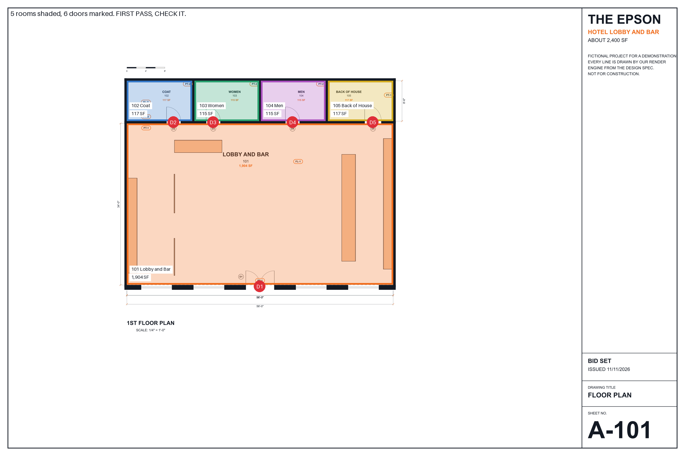

# PLANS: turn a plan set into a takeoff and a first-pass price

The guide is [plans.md](plans.md). Copy its prompt into ChatGPT or Claude with your plan set, or give the whole file to Claude.

You get a marked-up plan, a takeoff by room, a list of flags and a first-pass price from your own rate sheet.

The [skill folder](skill/) runs the same method in Claude Code. A small script re-adds every column, draws the marked-up plan and prices it. It sends nothing anywhere.

## How good is it

On the demo set, every room area and total landed within 0.2 percent of the drawing's true number, and every door, chair, table and plant count was exact.

| Quantity | The AI said | My own pipeline | The drawing's true number | Off by |
|---|---|---|---|---|
| Rooms | 5 | 5 | 5 | exact |
| Floor, all rooms | 2,368 SF | 2,370 SF | 2,367 SF | 0.03 percent |
| Floor, worst room (103, 104) | 115 SF | 115.4 SF | 114.8 SF | 0.17 percent |
| Ceiling | 2,368 SF | 2,367 SF, from the 3D model | 2,367 SF | 0.03 percent |
| Base | 326 LF | 324 LF | 326 LF | exact |
| Walls, perimeter x height | 4,113 SF | 4,533 SF, one 14 ft height for every room, so high | 4,113 SF | exact |
| Walls, glass and doors taken out | not asked for | 3,423 SF, from the 3D model | 3,423 SF | its 4,113 runs 20 percent above this, and it flagged why |
| Doors | 6 (5 marks, one pair) | 6 | 6 | exact |
| Chairs and stools | 21 | 21, from the 3D model | 21 | exact |
| Tables | 7 | 7, from the 3D model | 7 | exact |
| Plants | 6 | not counted | 6 | exact |
| Light fixtures | not counted, flagged | 28, from the 3D model | not on any sheet | flagged, as it should be |

The true numbers come from the design file our engine drew the sheets from. "My own pipeline" is my takeoff scripts on the same sheets, plus the 3D model where the sheets show nothing.

The wall row is the honest gap. The prompt keeps glass and doors in the wall area, then flags them. The AI flagged the storefront glass at about 450 SF. Take that out yourself, or tell your AI to.

Two engines agree. The answer in [examples](examples/epson-takeoff.md) is Claude Opus 5.5. A second run on OpenAI's model, through its Codex tool rather than the ChatGPT app, gave the same areas, base, walls and doors.

What both missed: the sheets have no furniture legend, so neither could name the rails, drapes or center table. Both counted them and flagged the names as guesses.

One judgment call: the Claude run priced 4 doors, not 6, because the entry pair is bronze, not painted. It said so in its flags. The script prices whatever the takeoff says, so it prices all 6 until you change it.

The demo job, The Epson, is not a real building. Our render engine drew the set, so these are clean, computer-drawn sheets with printed room areas. That is the best case. Expect more flags and more misses on scans, photos and hand sketches. A person checks every number before it goes to a client.

## The example files

| File | What it is |
|---|---|
| [epson-sheet-G-001.png](examples/epson-sheet-G-001.png) to [epson-sheet-A-601.png](examples/epson-sheet-A-601.png) | The four demo sheets the AI read: cover, floor plan, furniture plan, schedules |
| [epson-takeoff.md](examples/epson-takeoff.md) | The AI's real answer to the prompt, as it came back |
| [epson-takeoff.json](examples/epson-takeoff.json) | The takeoff part of that answer, ready for the skill's script |
| [epson-marked-up.png](examples/epson-marked-up.png) | The marked-up plan the script drew from that takeoff |
| [epson-price.md](examples/epson-price.md) | The first-pass price the script worked out |
| [example-rates.csv](examples/example-rates.csv) | Example rates, replace with yours. Made-up round numbers |

To undo, delete the file or the folder.

What it reads, writes and sends, and the license, are on the [main page](../README.md).
