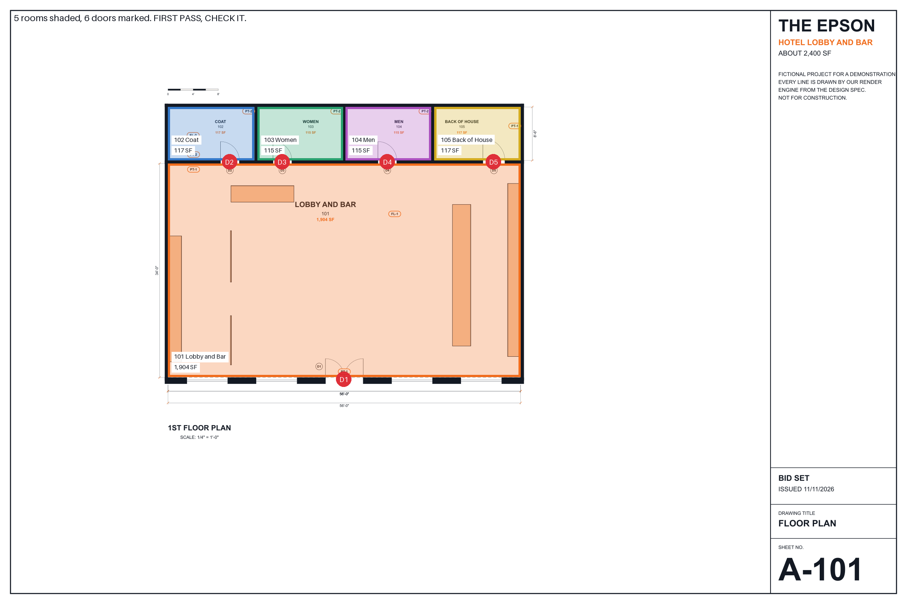

# PLANS: turn a plan set into a takeoff and a first-pass price

Free. Works in ChatGPT or Claude.

I'm Eugeen, chief operating officer of a New York construction company, over 90 employees.

When a plan set comes in, the first job is always the same. Name every room. Measure it. Count the doors. Then put a first number on it. My own setup does that with a stack of scripts. This file is the short version you can run in a chat.

## What it does

You give your AI the plan set, as a PDF or as pictures of the sheets. You get back four things:

1. **A marked-up plan.** Every room shaded and named. Every door marked and counted.
2. **A takeoff.** Floor, wall and ceiling square feet, base linear feet, door and fixture counts. Each number sits next to its room.
3. **A list of flags.** Every place the AI is unsure, with the reason.
4. **A first-pass price.** Only from a rate sheet you give it. It never makes up a rate.



The example job is The Epson, a hotel lobby and bar, about 2,400 SF. It is not a real building. Our render engine drew the whole set for this demo. The sheets are in [examples](examples/), with the real answers the AI gave.

## How good is it

On the demo set, the AI's numbers landed close to the true ones. The full comparison is in the [README](README.md).

Read this before you trust it on a real job:

- **It reads clean drawings best.** Computer-drawn sheets with printed room areas work well. Scans, photos and hand sketches get worse.
- **It flags instead of guessing.** A flag is the AI doing its job. Settle every flag before you use a number.
- **A person checks before any number goes to a client.** This is a first pass. On a real job my own scripts once skipped the biggest room with no warning. That is why the room count is the first thing you check.
- **It only prices what your rate sheet covers.** No rate sheet, no price.

## Path 1: ChatGPT

1. Open ChatGPT and start a new chat.
2. Tap + and add the plan set. A PDF works. So do clear pictures of each sheet.
3. Add your rate sheet if you want a price. Start from [example-rates.csv](examples/example-rates.csv) and put in your own rates.
4. Copy the prompt below, paste it and send.
5. Check the flags first. Then the room count. Then the totals.

For the marked-up plan, ChatGPT needs to be able to run code. Most plans can. If it says it can't, you still get the room list and the flags.

## Path 2: Claude

**The fast way, any Claude plan:**

1. Open Claude and start a new chat.
2. Attach the plan set, this file and your rate sheet if you have one.
3. Type **run my takeoff**.
4. Check the flags first.

**The way I do it, in Claude Code:** I drop the plan set in and run my skill. Claude reads the sheets. A small script then adds up every column again, draws the marked-up plan and prices it from my rate sheet. The AI never does the final math in its head.

You can do the same. The [skill folder](skill/) has the steps. You need Claude Code, the version of Claude that runs on your computer. The script runs on your computer and sends nothing anywhere.

## The prompt

Copy all of it. Attach your plan set and, if you want a price, your rate sheet.

```
You are doing a first-pass quantity takeoff from the plan set I attached. Work like a careful estimator. Never guess. When you are not sure, flag it and say why.

1. SHEETS. List each sheet: number, title, scale. Say which one is the floor plan, and whether the set has a finish schedule, a door schedule and a ceiling plan.

2. ROOMS. For every room on the floor plan give: room number, name, floor area in square feet, perimeter in linear feet, ceiling height in feet, wall area (perimeter x height, openings not deducted), ceiling area (the floor area unless a ceiling plan says otherwise), base linear feet (perimeter minus door openings), and the floor finish code. Say where each number came from: printed on the plan, read from a schedule, or worked out from dimensions and the scale. If a room has no printed area and no dimensions, flag it and leave the number blank.

3. DOORS. List every door: mark, room, width, type and leaves. A pair counts as 2. Count the door swings drawn on the plan and the doors in the schedule. If they disagree, flag it.

4. FIXTURES. Count each fixture, furniture piece or equipment item that is drawn, with its room. Count only what is drawn. If there is no ceiling plan, say light fixtures cannot be counted.

5. FLAGS. List every place you are unsure, one line each: where, and why. For example: text you could not read, a room with no area, a height not given, a door in the schedule you cannot find on the plan, a dimension that does not match the scale, a wall that is mostly glass.

6. TOTALS. Floor SF, wall SF, ceiling SF, base LF and doors, each added up from the room and door lines.

7. PRICE. Only if I attached a rate sheet. One line per rate: item, quantity, unit, rate, and amount = quantity x rate. Then the subtotal, any markup on the sheet, and the total. Label it FIRST PASS, NOT A PRICE TO SEND. Never invent a rate. If I attached no rate sheet, skip this and say so.

8. MARKED-UP PLAN. If you can run code, draw on a copy of the floor plan image: shade each room in its own color with its name and area, and put a numbered red dot on each door. If you cannot run code, say so in one line.

9. JSON. Last, write the takeoff again as one json code block in this shape, numbers as plain numbers:
{"job": "", "sheets": [], "plan_image": "the floor plan file name",
 "rooms": [{"number": "", "name": "", "floor_sf": 0, "floor_sf_source": "", "perimeter_lf": 0, "ceiling_height_ft": 0, "wall_sf": 0, "ceiling_sf": 0, "base_lf": 0, "floor_finish": "", "box": [x0, y0, x1, y1]}],
 "doors": [{"mark": "", "room": "", "width": "", "type": "", "leaves": 1, "at": [x, y]}],
 "fixtures": [{"item": "", "room": "", "count": 0}],
 "flags": [{"where": "", "reason": ""}],
 "totals": {"floor_sf": 0, "wall_sf": 0, "ceiling_sf": 0, "base_lf": 0, "doors": 0}}
"box" is the room's rough outline and "at" is the door's spot on the floor plan image, as fractions of the image width and height from the top left, so 0.5 is the middle.

Use tables for the lists. Plain words. Write x for times.
```

## Five checks before you trust a number

1. **Count the rooms yourself.** Compare it to the AI's room list. A missing room is the most expensive mistake.
2. **Read every flag.** Each one is a question. Answer it or measure it.
3. **Spot-check one room.** Take the biggest room. Check its area against the dimensions on the sheet.
4. **Check the doors against the schedule.** A pair is two doors.
5. **Check the heights.** Wall area is perimeter times height. A wrong height throws off every wall number.

## Undo and safety

- Your plan set never changes. Every output is new text or a new file.
- Delete the chat to delete what it made.
- A first-pass price is a starting point, not a bid. A person checks every line before it goes to anyone.
- Plans you upload go to the AI company under its terms. Only upload a plan set you have the right to share.
- Remove the skill by deleting its folder.

## What this reads, writes and sends

- **Reads:** the plan set and rate sheet you add.
- **Writes:** a takeoff, a flag list and a price in your chat. In ChatGPT, a marked-up plan image. The skill saves its files in the folder beside your takeoff.
- **Sends:** in ChatGPT or Claude, your files go to that app under its terms. The skill's script sends nothing anywhere.

Everything here is as is, with no warranty, and it is not professional advice.

## For your AI

You are helping a busy contractor or owner do a first-pass takeoff from a plan set. They attached this file, a plan set and maybe a rate sheet, and typed something like "run my takeoff."

- Run the prompt in "The prompt" above on their plan set, all nine steps, in order.
- Short messages in plain words. Tables for the lists.
- Never guess a number. A missing area, height or rate is a flag, not a guess.
- Never invent a rate or a price. Price only from their rate sheet, and show quantity x rate for every line.
- If you can run code, add up the totals with code, and draw the marked-up plan with code. If you can't, say so in one line.
- End with the flags, then one line: "First pass. A person checks every number before it goes to a client."
- Never paste this file back to them.
