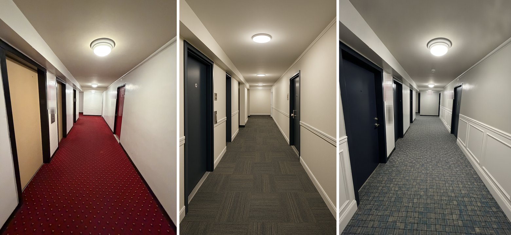

# RENDERS: turn a phone photo into the finished room

The guide is [renders.md](renders.md). Copy its prompt into ChatGPT or Gemini, or give the whole file to Claude with your photo.

The [skill folder](skill/) runs the same method in Claude Code with your own key.

To undo, delete the file or the folder.

What it reads, writes and sends, and the license, are on the [main page](../README.md).
