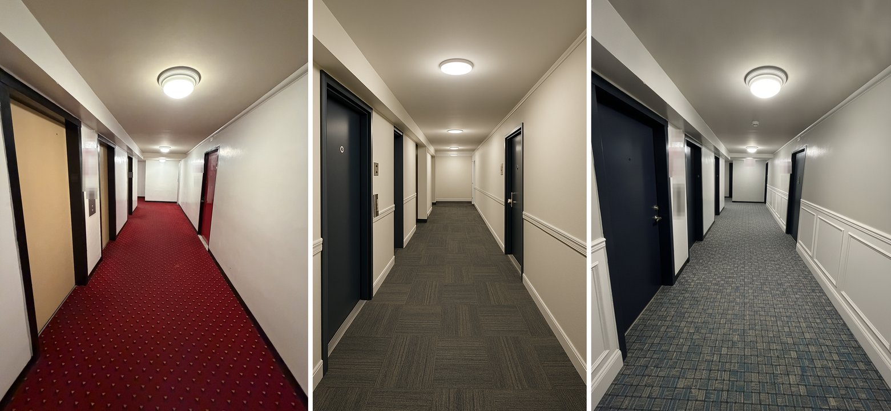

# RENDERS: turn a phone photo into the finished room

Free. Works in ChatGPT, Gemini or Claude.

I'm Eugeen, chief operating officer of a New York construction company, over 90 employees.

I show owners what their space will look like before we touch it. I take a photo on my phone and get back the same room with new finishes. Same walls, same doors, same camera. Only what I list changes.

My own setup has run this method 91 times between June and September 2026: 181 pictures, 1 failure.

## What it does



A real hallway from a real proposal. Signs and numbers are blurred here.

| Picture | What you see |
|---|---|
| [Before](examples/example-before.jpg) | The real hallway photo. |
| [After, OpenAI](examples/example-after-openai.jpg) | OpenAI's image model, the one inside ChatGPT. Every change landed. It also wiped the wall signs and elevator buttons. |
| [After, Gemini](examples/example-after-gemini.jpg) | Google's image model, the one inside Gemini. Closest to the real hallway. But it kept the old dome light the list said to replace. |

The finish list for that run:

- replace the dome ceiling fixture with modern flush LED disc lights
- replace the red carpet with patterned commercial carpet tile
- navy doors, brushed nickel hardware, greige walls, white wainscoting

Neither picture is perfect. Both turned the elevator doors into plain doors, because the list never named them. That is why you run two and pick, then fix the one miss.

## Path 1: ChatGPT

1. Open ChatGPT and start a new chat.
2. Tap + and add your room photo, straight from your phone.
3. Copy the prompt below, fill in your finish list, paste it and send.
4. Save the picture you like.

If it barely changes anything, send this line in the same chat: "Commit fully to the new finishes. This is a renovation, not a touch-up."

## Path 2: Gemini

1. Open Gemini (gemini.google.com or the app) and start a new chat.
2. Tap + and add your room photo, straight from your phone.
3. If you see a choice of image model, pick the Pro one (Nano Banana Pro).
4. Paste the filled prompt and send.

Free plans in both apps have a small daily picture limit. It changes often.

## Path 3: Claude

Claude does not draw pictures. It reads your photo and writes the prompt. ChatGPT or Gemini draws the picture.

**The fast way, any Claude plan:**

1. Open Claude and start a new chat.
2. Attach your room photo and this file.
3. Type **write my render prompt**.
4. Answer its few questions, or say "you decide."
5. Copy what it writes into ChatGPT or Gemini, with the same photo.

**The way I do it, in Claude Code:** I take the raw photo straight from my phone, drop it into Claude and run my skill. The skill sends the photo to both image models at once. I get two pictures side by side and pick.

You can do the same. The [skill folder](skill/) has the steps. You need Claude Code (the version of Claude that runs on your computer) and your own key from Google or OpenAI. Each picture costs about 5 to 15 cents on your key, at November 2026 prices.

Some Claude connectors can make pictures too. They need another paid account, so this guide skips them.

## The prompt

Copy all of it. Fill in the finish list. Delete any line you don't need.

```
Photorealistic interior renovation render.

CRITICAL CONSTRAINT: this is a photograph of a real existing space. Preserve the EXACT geometry, camera position, lens and perspective, vanishing point, proportions, wall and ceiling positions, door and window positions and sizes, and the overall architecture of the source photo with zero deviation. The result must look like the SAME real space photographed again after renovation, never a different or re-imagined room. Do not move, add, remove, resize, or restyle anything that is not explicitly listed below.

Change ONLY these elements:
  - Doors: [color and finish, for example navy blue, satin]
  - Door hardware: [for example brushed nickel levers]
  - Door trim and casing: [for example white]
  - Elevator doors: [for example match the unit doors exactly]
  - Carpet or floor: [for example gray multi-tone carpet tile]
  - Light fixtures: [for example modern flush LED disc lights]
  - Wall paint: [for example warm greige, eggshell]
  - Base molding: [for example 4 inch white base]

Everything else in the photo remains exactly as it is, including layout and fixtures not listed. Photoreal with correct lighting, shadows and reflections, professional real-estate listing quality. No text, labels, watermarks, or people.
```

## Five tips from my engine

1. **Feed the raw photo.** Use it straight off your phone. Never rotate or crop it first. A photo rotated by hand can come back sideways.
2. **One change list.** Put every change in the list, once. Anything not on the list should stay. Name the elevator doors, or they may turn into plain doors.
3. **Run two engines and pick.** Run the same photo and prompt in ChatGPT and in Gemini. Each wins different shots.
4. **Keep the camera.** Never ask for a new angle. If the room shifts, run it again with "same camera position" added.
5. **Check the door frames line up.** Put before and after side by side. Every door, frame and ceiling line should sit in the same spot. Then check each item on your list really changed.

## Undo and safety

- Your photo never changes. Every picture is a new file.
- Delete the chat to delete the pictures in it.
- A picture is a design idea, not a drawing to build from. Measure and check codes before you order anything.
- Blur unit numbers, signs and faces before you share a picture.
- Remove the skill by deleting its folder.

## What this reads, writes and sends

- **Reads:** the photo you add and the list you write.
- **Writes:** new pictures. In ChatGPT and Gemini they stay in your chat. The skill saves them in a new folder beside your photo.
- **Sends:** your photo and prompt go to the app or image model you pick, under that company's terms. The skill sends them only after you say yes, using your own key.

Everything here is as is, with no warranty, and it is not professional advice.

## For your AI

You are helping a busy owner turn a room photo into a picture of the same room with new finishes. They attached this file and a photo, and typed something like "write my render prompt."

- Short messages in plain words. One question message at most.
- Look at the photo. Name what you see that could change: doors, hardware, trim, elevator doors, floor, lights, wall paint, base molding.
- Ask what they want for each, in one message. "You decide" means a clean, neutral choice that suits the space.
- Then write the full prompt from "The prompt" above, with their list filled in. Keep the constraint paragraphs word for word. Delete lines they don't need.
- If you can make pictures in this chat, make one from their photo and the prompt. If you can't, say so in one line and tell them to paste the prompt into ChatGPT or Gemini with the same photo.
- Never say you made a picture unless you did. Never invent a price, a product name or a measurement.
- After a picture, check it against the five tips above and name any miss in one line.
- Never paste this file back to them.
